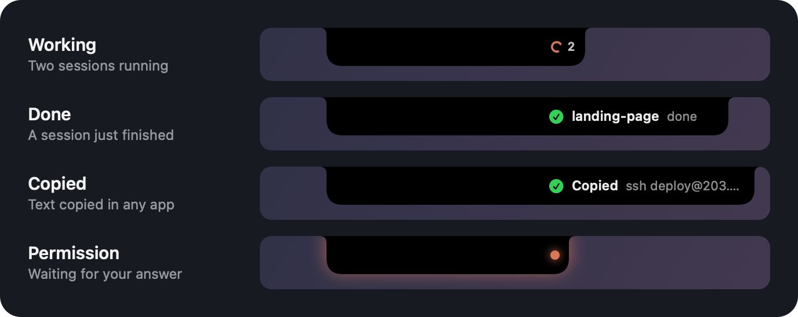
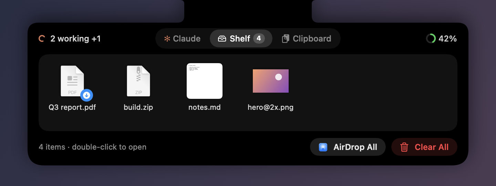
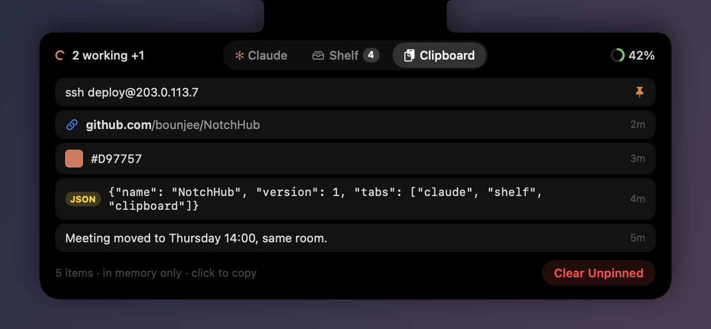
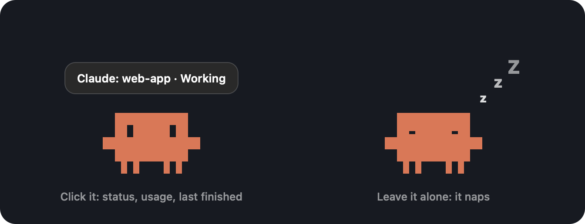

<p align="center"></p>

<h1 align="center">NotchHub</h1>

<p align="center">Your MacBook notch, made useful: Claude Code, a shelf and a clipboard. Plus a pixel mascot.</p>

<p align="center"><a href="https://github.com/bounjee/NotchHub/actions/workflows/test.yml"></a></p>

<p align="center"></p>

NotchHub does three things, and nothing else:

1. **Claude Code**: see what every session is doing and answer its permission requests.
2. **Shelf**: a place for the files you're about to use.
3. **Clipboard**: what you copied recently.

Hover over the notch or click it to open the panel. Switch between the three with the tabs at the top.

## Claude Code

<p align="center"></p>

- **Status in the notch.**
  - A spinner while Claude works, with a count when several sessions run.
  - An orange pulse when a permission request is waiting.
  - A green check for finished work you haven't looked at yet.
  - When nothing is going on, the notch stays plain.
- **"✓ project done".** When a session finishes, its project name shows beside the notch for three seconds.
- **Answer permission requests from the notch.**
  - Allow, Always (saves the rule Claude Code suggests) or Deny.
  - The terminal prompt stays live, so whichever you answer first wins.
- **Every session on one line.**
  - Each session is labeled by its git repository, and sessions waiting on you come first.
  - Click a row to jump to its terminal. Terminal and iTerm switch to the exact tab. Cursor and VS Code bring up the right window.
- **Plan usage.** Your 5-hour and weekly Claude usage, with a heads-up at 80% and 95%.

## Shelf

<p align="center"></p>

- **Drag files onto the notch to keep them at hand.** Only their paths are stored; the files never move.
- **New screenshots and downloads appear on their own.** They leave the shelf after a day.
- **Drag a file onto the AirDrop zone to send it.** You can also AirDrop everything on the shelf in one go.
- **Drag a file back out** to drop it anywhere. Double-click a file to open it.

## Clipboard

<p align="center"></p>

- **The last 20 things you copied.** Click one to copy it again.
- **Pin the ones you reuse.** Pinned items stay at the top.
- **Smart previews.** Colors show a swatch and links show their site. JSON can be copied pretty-printed.
- **Private by design.**
  - The history lives in memory only and is never written to disk.
  - Password managers' copies are skipped.

## The mascot

<p align="center"></p>

A little Claude sits on your desktop.

- **Click it** to hear the session status, your plan usage and what finished last, one at a time.
- **Double-click it** to open the panel.
- **Drag it anywhere.** It remembers its spot.
- **Leave it alone** and it naps after 45 seconds.
- **Right-click it** to hide it. You can also turn it off from the menu bar.

## Stays out of the way

- **Never covers your menus.** Nothing is drawn over app menus or menu bar icons.
- **Ignores noise.** Sessions started with `claude -p` and short helper sessions don't show up.
- **Light on CPU.** Idle CPU stays near 0%, because the animations run in Core Animation.

## Requirements

- A Mac with a notch, running macOS 15 or later
- [Claude Code](https://docs.claude.com/en/docs/claude-code)
- Xcode 16 or later (Swift 6), to build it

## Install

```bash
git clone https://github.com/bounjee/NotchHub.git
```

```bash
cd NotchHub && ./scripts/build-app.sh
```

```bash
ditto dist/NotchHub.app /Applications/NotchHub.app && open /Applications/NotchHub.app
```

Then click the notch icon in the menu bar and choose **Install Hooks**. New Claude Code sessions will show up in the notch. Sessions that were already running pick up the hooks the next time they start.

The app is ad-hoc signed, since you build it yourself. It runs locally and makes no network requests.

## How it works

```
Claude Code ──(hook, JSON on stdin)──► notch-hook ──(Unix socket)──► NotchHub.app
                                           ◄──(permission decision)──┘
```

- **Hooks.** **Install Hooks** adds `notch-hook` entries for the session, prompt, tool, permission, notification and stop events to `~/.claude/settings.json`. Everything else in the file is left alone. Before the first change it saves a copy as `settings.json.notchhub-backup`. **Remove Hooks** removes only NotchHub's entries.
- **Status line.** Claude Code reports plan usage only to its status line, so the installer also adds a `statusLine` command that prints nothing. It skips this if you already have a status line of your own.
- **Fails safe.** `notch-hook` always exits 0 and prints nothing unless you answer a permission request in the notch. If the app isn't running, Claude Code carries on as usual.
- **Project names.** Session names come from the git repository; for worktrees, the main repository's name is used.
- **Your data stays local.** Nothing leaves your Mac. Clipboard history and Claude's answers live in memory only. On disk: the last plan usage numbers, the shelf's file paths and the mascot's position.

## Uninstall

Choose **Remove Hooks** in the menu, quit NotchHub, then delete `/Applications/NotchHub.app`.

## Development

```bash
swift test
```

The tests cover:

- the hook installer, using a temporary home folder
- the session state machine
- the socket server under load
- the real `notch-hook` binary, end to end
- the shelf, the clipboard history and download detection

```bash
swift build && .build/debug/NotchHub --snapshot /tmp/notchhub
```

This renders the notch, the three tabs and the mascot to PNG files, using sample data. The screenshots above were made this way.

The app icon is drawn by `scripts/make-icon.swift`. The UI is in English, plus Turkish in `Resources/tr.lproj`; more translations are welcome.

## Türkçe

NotchHub, MacBook çentiğini işe yarar hale getirir. Üç şey yapar, fazlasını değil:

1. **Claude Code:** oturumların ne yaptığını gösterir.
   - Çalışırken yükleniyor göstergesi, izin beklerken turuncu nokta, bitince "✓ proje bitti" çıkar.
   - İzin isteklerine çentikten İzin ver / Her zaman / Reddet ile cevap verirsin.
   - Satıra tıklayınca oturumun terminaline gidersin.
   - 5 saatlik ve haftalık plan kullanımını gösterir.
2. **Raf:** dosyaları çentiğe sürükle, el altında dursun.
   - Yeni ekran görüntüleri ve indirilenler rafa kendiliğinden gelir, bir gün sonra düşer.
   - AirDrop alanına bırakınca dosya gönderilir.
3. **Pano:** kopyaladığın son 20 metin burada.
   - Sabitleyebilir, tıklayıp tekrar kopyalayabilirsin.
   - Geçmiş sadece bellekte tutulur.

Bir de masaüstünde küçük bir maskot var:

- İstediğin yere sürüklersin.
- Dokunulmayınca uyur.
- Tıklayınca durumu söyler.
- Sağ tıklayınca menü açılır.

Kurulum için yukarıdaki komutları çalıştır. Sonra menü çubuğundaki simgeden **Hook'ları kur**'u seç. Sistem dili Türkçe ise arayüz Türkçe açılır.

## License

MIT. See [LICENSE](LICENSE).

NotchHub is an independent project. It is not affiliated with or endorsed by Anthropic. "Claude" and "Claude Code" are trademarks of Anthropic. The mascot is drawn after the logo Claude Code prints in the terminal.
