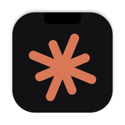
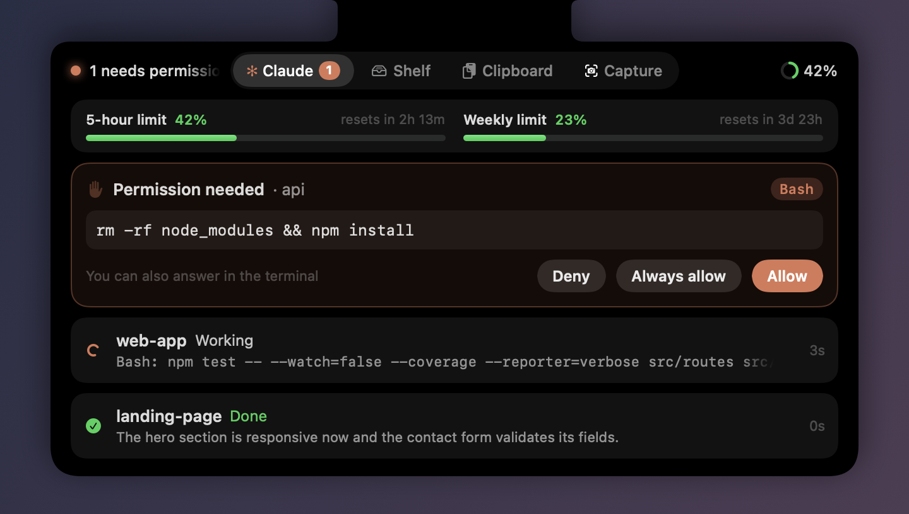
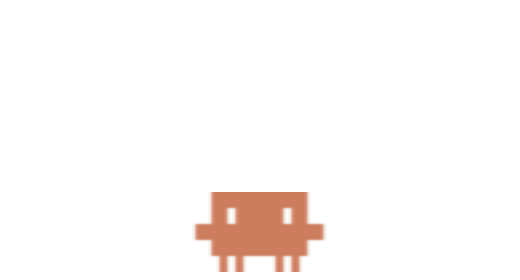

<p align="center"></p>

<h1 align="center">NotchHub</h1>

<p align="center">A small, focused Claude Code companion for the MacBook notch, with a pixel mascot.</p>

<p align="center"><a href="https://github.com/bounjee/NotchHub/actions/workflows/test.yml"></a></p>

<p align="center"></p>

NotchHub keeps an eye on your Claude Code sessions from the notch. It shows what each session is doing, tells you when one finishes, and lets you approve permission requests without switching to the terminal. A pixel mascot can sit on your desktop and nap until something happens. That's all it does.

## Features

- **Status in the notch.** A spinner while Claude works (with a count when several sessions run), an orange pulse when a permission is waiting, and a green check for finished work you haven't looked at yet. When nothing is going on, the notch stays plain.
- **"✓ project done".** When a session finishes, its project name appears beside the notch for three seconds. If several finish together, they're announced one after another.
- **Answer permission requests from the notch.** Choose Allow, Always (saves the rule Claude Code suggests) or Deny. The terminal prompt stays live, so whichever you answer first wins.
- **Every session at a glance.** Hover over the notch (or click it) to see one line per session, labeled by its git repository. Sessions waiting on you come first. Click a row to jump to its terminal; Terminal and iTerm switch to the exact tab.
- **Plan usage.** Shows your 5-hour and weekly Claude usage, with a heads-up at 80% and 95%.
- **Desktop mascot.**
  - Drag it anywhere; it remembers its spot.
  - It naps when left alone.
  - Click it for status, usage, and the latest finished session.
  - Double-click it to open the panel.
  - Right-click it for options, including hiding it.
- **Stays out of the way.**
  - Nothing is ever drawn over your app menus or menu bar icons.
  - Sessions started with `claude -p` and short helper sessions are ignored.
  - Idle CPU stays near 0%, because the animations run in Core Animation.

| Working | Done | Permission |
| :-: | :-: | :-: |
|  |  |  |

<p align="center"> </p>

## Requirements

- A Mac with a notch, running macOS 15 or later
- [Claude Code](https://docs.claude.com/en/docs/claude-code)
- Xcode 16 or later (Swift 6), to build it

## Install

```bash
git clone https://github.com/bounjee/NotchHub.git
```

```bash
cd NotchHub && ./scripts/build-app.sh
```

```bash
ditto dist/NotchHub.app /Applications/NotchHub.app && open /Applications/NotchHub.app
```

Then click the notch icon in the menu bar and choose **Install Hooks**. New Claude Code sessions will show up in the notch. Sessions that were already running pick up the hooks the next time they start.

The app is ad-hoc signed, since you build it yourself. It runs locally and makes no network requests.

## How it works

```
Claude Code ──(hook, JSON on stdin)──► notch-hook ──(Unix socket)──► NotchHub.app
                                           ◄──(permission decision)──┘
```

- **Hooks.** **Install Hooks** adds `notch-hook` entries for the session, prompt, tool, permission, notification and stop events to `~/.claude/settings.json`. Everything else in the file is left alone. Before the first change it saves a copy as `settings.json.notchhub-backup`. **Remove Hooks** removes only NotchHub's entries.
- **Status line.** Claude Code reports plan usage only to its status line, so the installer also adds a `statusLine` command that prints nothing. It skips this if you already have a status line of your own.
- **Fails safe.** `notch-hook` always exits 0 and prints nothing unless you answer a permission request in the notch. If the app isn't running, Claude Code carries on as usual.
- **Project names.** Session names come from the git repository; for worktrees, the main repository's name is used.
- **Your data stays local.** Answers and usage are kept in memory. The only things written to disk are the last plan usage numbers and the mascot's position.

## Uninstall

Choose **Remove Hooks** in the menu, quit NotchHub, then delete `/Applications/NotchHub.app`.

## Development

```bash
swift test
```

The tests cover the hook installer (with a temporary home folder), the session state machine, the socket server under load, and the real `notch-hook` binary end to end.

```bash
swift build && .build/debug/NotchHub --snapshot /tmp/notchhub
```

This renders every notch state and the mascot to PNG files, using sample sessions. The screenshots above were made this way.

The app icon is drawn by `scripts/make-icon.swift`. The UI is in English, plus Turkish in `Resources/tr.lproj`; more translations are welcome.

## Türkçe

NotchHub, MacBook çentiğinde Claude Code oturumlarını izleyen küçük bir yardımcı:

- **Çentik durumu:** çalışırken yükleniyor göstergesi, izin beklerken turuncu nokta, bitince "✓ proje bitti".
- **İzin onayı:** izin isteklerine çentikten İzin ver / Her zaman / Reddet ile cevap verebilirsin.
- **Oturum listesi:** her oturum git deposunun adıyla görünür; satıra tıklayınca terminaline gidilir.
- **Plan kullanımı:** 5 saatlik ve haftalık limit gösterilir.
- **Masaüstü maskotu:** istediğin yere sürüklenir, dokunulmayınca uyur, tıklayınca bilgi verir, sağ tıkta menü açar.

Kurulum için yukarıdaki komutları çalıştır, sonra menü çubuğundaki simgeden **Hook'ları kur**'u seç. Sistem dili Türkçe ise arayüz Türkçe açılır.

## License

MIT. See [LICENSE](LICENSE).

NotchHub is an independent project. It is not affiliated with or endorsed by Anthropic. "Claude" and "Claude Code" are trademarks of Anthropic. The mascot is drawn after the logo Claude Code prints in the terminal.
